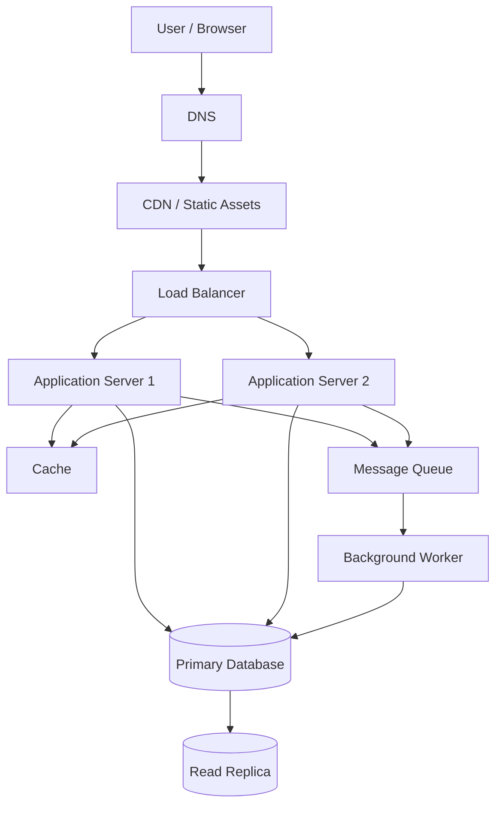

# QuickNotes System Architecture

## 1. Overview

QuickNotes is a note-taking application that allows users to create, view, update, delete, search, and organise their notes. This document describes a scalable architecture designed to support growth from a small user base to one million registered users.

## 2. Functional Requirements

- Users can register and log in securely.
- Users can create, view, update, and delete their own notes.
- Users can search notes by title or content.
- Users can organise notes using tags.
- Users can receive clear loading, success, and error messages.
- Users can access their notes from supported devices.

## 3. Non-Functional Requirements

- **Availability:** Target 99.9% service availability.
- **Performance:** Aim for common note reads to complete within 300 ms under normal load.
- **Scalability:** Add application servers as traffic increases.
- **Security:** Use HTTPS, secure password hashing, authentication, and ownership checks.
- **Reliability:** Back up the database and monitor failures.
- **Maintainability:** Separate the user interface, API, database, and background processing.
- **Privacy:** Collect only necessary personal data and restrict access to private notes.

These are design targets, not measured production results.

## 4. Capacity Estimates for One Million Users

The following are planning assumptions, not measured traffic.

Assume:
- 1,000,000 registered users.
- 10% of users active each day: 100,000 daily active users.
- Each active user makes 20 read requests and 2 write requests per day.
- Average stored note data is 5 KB per note.
- Each active user creates 2 notes per day.
- One year contains 365 days.

### Request estimates

Daily reads:

100,000 users × 20 reads = 2,000,000 reads/day.

Average reads per second:

2,000,000 ÷ 86,400 ≈ 23 reads/second.

Daily writes:

100,000 users × 2 writes = 200,000 writes/day.

Average writes per second:

200,000 ÷ 86,400 ≈ 2.3 writes/second.

Peak traffic can be much higher than these averages, so capacity testing and monitoring are necessary.

### Storage estimate

New notes per year:

100,000 active users × 2 notes/day × 365 days = 73,000,000 notes/year.

At an average of 5 KB per note:

73,000,000 × 5 KB = approximately 365 GB of new note data per year.

This estimate excludes indexes, database overhead, backups, attachments, and replicas. Actual storage requirements will depend on usage.

## 5. Architecture Diagram

## 6. Component Responsibilities

- **Client:** Displays notes and sends API requests.
- **DNS:** Resolves the application's domain name.
- **CDN:** Delivers static assets such as CSS, JavaScript, and images.
- **Load balancer:** Distributes API traffic across healthy application servers.
- **Application servers:** Validate requests, authenticate users, enforce permissions, and implement business logic.
- **Cache:** Stores suitable frequently accessed data to reduce repeated database reads. Private cached data must be isolated by user and invalidated when changed.
- **Primary database:** Stores authoritative user, note, and tag records and handles writes.
- **Read replica:** Serves eligible read queries to reduce pressure on the primary database. Replication lag must be considered.
- **Message queue:** Holds background tasks for processing outside the main request.
- **Background worker:** Handles tasks such as notifications and other asynchronous work.

## 7. GET /notes Request Flow

1. The user opens the notes page.
2. The client sends `GET /notes` with authentication credentials.
3. DNS resolves the service address and the load balancer selects a healthy application server.
4. The server authenticates the user and checks their permissions.
5. The application checks the cache for an appropriate user-specific result.
6. If the cache misses, the application queries the database or a suitable read replica.
7. The server returns the user's notes as JSON with an appropriate HTTP status.
8. The client displays the notes or an empty state.

## 8. POST /notes Request Flow

1. The user submits a note through the client.
2. The client sends `POST /notes` with a JSON body and authentication credentials.
3. The load balancer forwards the request to a healthy application server.
4. The server authenticates the user and validates the title and body.
5. The application derives the owner from the authenticated identity, rather than trusting a user ID supplied by the client.
6. The primary database stores the note in a transaction.
7. The server returns `201 Created` with the created note.
8. The application invalidates or updates relevant cached data. Any optional notification task can be placed on the queue.

## 9. Trade-offs

### SQL versus NoSQL

A relational database such as PostgreSQL is a good starting choice because notes, users, and tags have clear relationships and benefit from transactions, foreign keys, and constraints. A NoSQL database could be considered if future access patterns or scale justify its different data model and consistency trade-offs.

### Caching

Caching can improve read performance and reduce database load, but it introduces invalidation complexity and may serve stale data. Start by caching appropriate read-heavy data and measure the benefit before expanding caching.

### Read replicas

Read replicas improve read capacity but may return slightly outdated data. Requests requiring immediate consistency should use the primary database.

### Background processing

A queue keeps slow tasks out of the main request path. It adds operational complexity, so tasks need retries, monitoring, and safe handling of duplicate processing.

## 10. Avoiding Single Points of Failure

- Run at least two application server instances across separate failure domains.
- Use a highly available load balancer.
- Deploy the database with managed failover or a tested primary-and-standby strategy.
- Keep tested backups and regularly practise restoration.
- Monitor service health, latency, errors, storage, and queue depth.
- Use retries with limits, timeouts, and circuit-breaking where appropriate.
- Keep secrets out of source control and rotate credentials securely.
- Test recovery procedures and document operational responsibilities.

## 11. Conclusion

This architecture starts with a clear separation between the client, API, and relational database. Load balancing, caching, read replicas, and background workers provide options for scaling as usage grows. The system should add complexity only when monitoring and real traffic show that it is needed.
